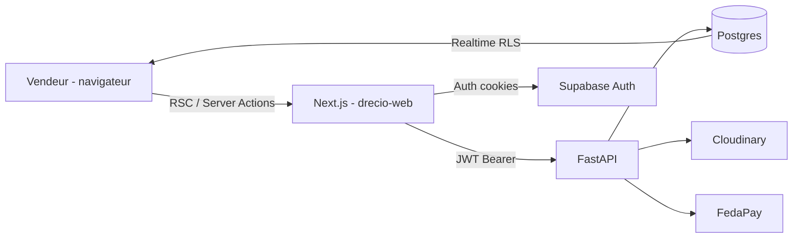

# Architecture Frontend — Drecio Web (Next.js + shadcn)

> Version 1.0 — alignée sur `drecio-fastapi` et l’architecture backend v2.0 (Cloudinary, FedaPay, Supabase, crédits Drec, RodiumAI).

## 1. Contexte & objectif

Le frontend est l’**app vendeur** : un user se connecte, uploade la photo d’un article, lance une génération virtual try-on (1 Drec), suit le statut en temps réel, puis recharge ses Drecs via FedaPay.

FastAPI reste la **seule source d’écriture métier**. Next.js orchestre l’UI, l’auth, et un BFF mince (Server Actions / Route Handlers) pour ne jamais exposer le backend ni les secrets au navigateur. Les images se consomment via les URLs Cloudinary déjà renvoyées par l’API.

Repo cible : `drecio-web` (`git@github.com:drecio-26/drecio-web.git`).

## 2. Choix techniques recommandés

| Besoin | Choix | Rôle |
|---|---|---|
| Framework | **Next.js 15** (App Router, TypeScript, `src/`) | RSC pour le 1er rendu, Server Actions pour les mutations |
| UI | **shadcn/ui** + Tailwind CSS | Composants copiés dans le repo (pas une lib runtime), thème Drecio |
| Auth | **Supabase Auth** (email + téléphone plus tard) | JWT HS256 déjà vérifié par FastAPI — zéro auth maison |
| Client API | **Server Actions + fetch serveur** vers FastAPI | Le JWT voyage cookie → serveur Next → `Authorization: Bearer` |
| Cache UI | **TanStack Query** (mutations + polling de secours) | Hydratation depuis les RSC quand c’est utile |
| Statut génération | **Supabase Realtime** sur `generations` | Filtre `user_id` ; polling `GET /v1/generations/{id}` en fallback |
| Formulaires | **react-hook-form** + **Zod** | Schémas alignés sur les payloads FastAPI |
| Images | **next/image** + loader Cloudinary | Miniatures / recadrage via transformations Cloudinary, pas d’upload client |
| Toasts | **Sonner** (déjà dans shadcn) | Succès / échec génération, Drec remboursé |
| Qualité | ESLint, Prettier, `next build` | Suffisant au MVP |

**Ce qu’on ne met pas au MVP** : Zustand/Redux (le serveur + Query suffisent), upload Cloudinary unsigned depuis le browser, WebSocket custom, monorepo partagé de types (on duplique les DTOs TypeScript, plus simple tant que l’API bouge).

## 3. Vue d'ensemble



Trois chemins, pas un seul bus :

1. **Lecture** — Server Component appelle FastAPI, rend HTML (liste d’articles, solde Drecs).
2. **Écriture** — Server Action envoie `FormData` / JSON à FastAPI (upload, génération, topup).
3. **Temps réel** — le client s’abonne à Supabase Realtime (statut `pending → processing → completed | failed`). FastAPI n’a pas de WebSocket.

## 4. Principes (à ne pas casser)

1. **FastAPI écrit, Next.js affiche.** Aucun crédit de Drecs, aucun statut de génération “inventé” côté front.
2. **Pas d’upload image direct vers Cloudinary** depuis le browser — le fichier passe Next → FastAPI → Cloudinary (modération / contrôle, comme le back).
3. **Le retour FedaPay dans le navigateur n’est pas une preuve de paiement.** On affiche “paiement en cours”, on attend le webhook (solde qui bouge via Realtime ou poll de `/v1/users/me/drecs`).
4. **Le JWT ne vit pas dans `localStorage`.** Session Supabase en cookies httpOnly (helper `@supabase/ssr`).
5. **Les domaines du back restent les domaines du front** : `articles`, `generations`, `credits`, `users`. Pas de couche “hexagonale” lourde côté UI — un *feature folder* par domaine suffit.

## 5. App Router — cartes et routes

Groupes de routes Next (layouts séparés) :

```
src/app/
├── (marketing)/                 # layout public, SEO
│   └── page.tsx                 # landing
├── (auth)/                      # layout centré, sans sidebar
│   ├── login/page.tsx
│   ├── signup/page.tsx
│   └── forgot-password/page.tsx
├── (dashboard)/                 # layout app : sidebar shadcn + header
│   ├── layout.tsx
│   ├── page.tsx                 # home : solde, dernières générations
│   ├── articles/
│   │   ├── page.tsx             # liste
│   │   ├── new/page.tsx         # upload
│   │   └── [id]/page.tsx        # détail + CTA générer
│   ├── generations/
│   │   ├── page.tsx
│   │   └── [id]/page.tsx        # statut live + image résultat
│   ├── credits/
│   │   ├── page.tsx             # packs Drecs
│   │   └── retour/page.tsx      # retour FedaPay (attente confirmation)
│   └── settings/page.tsx        # nom d’affichage (API `boutique_name`), téléphone
├── auth/callback/route.ts       # PKCE Supabase
└── middleware.ts                # protège (dashboard)
```

Mapping API (déjà implémenté) :

| Écran | Appel FastAPI |
|---|---|
| `/articles/new` | `POST /v1/articles` (multipart) |
| `/articles/[id]` | `GET /v1/articles/{id}` |
| CTA “Générer” | `POST /v1/generations` `{ article_id }` → 202 |
| `/generations/[id]` | `GET /v1/generations/{id}` + Realtime |
| Header solde | `GET /v1/users/me/drecs` |
| `/credits` | `POST /v1/credits/topup` → redirect `checkout_url` |
| Profil | `GET /v1/users/me` |
| Réglages | `PATCH /v1/users/me` `{ boutique_name?, phone? }` |
| Édition article (futur) | `PATCH /v1/articles/{id}` `{ title?, price_fcfa?, description? }` |

## 6. Structure des dossiers

Feature-sliced léger, calé sur le back — pas un dump `components/` de 80 fichiers.

```
src/
├── app/                         # routes uniquement (composition)
├── components/
│   ├── ui/                      # shadcn généré (button, card, dialog…)
│   └── layout/                  # AppSidebar, AppHeader, DrecBalance
├── features/
│   ├── auth/
│   ├── articles/                # UploadDropzone, ArticleCard, ArticleForm
│   ├── generations/             # StatusBadge, ResultFrame, useGeneration
│   ├── credits/                 # PackGrid, TopupButton
│   └── users/
├── lib/
│   ├── api/                     # client FastAPI typé (server-only)
│   │   ├── client.ts            # fetch + Bearer + erreurs métier
│   │   ├── articles.ts
│   │   ├── generations.ts
│   │   ├── users.ts
│   │   └── credits.ts
│   ├── supabase/
│   │   ├── client.ts            # browser
│   │   ├── server.ts            # cookies RSC / actions
│   │   └── middleware.ts
│   ├── realtime/generations.ts
│   └── utils.ts                 # cn() shadcn
├── types/
│   └── api.ts                   # miroir des schémas Pydantic
└── middleware.ts
```

Règle d’import : `app/` importe `features/` et `lib/`. `features/` n’importe pas `app/`. `components/ui` n’importe jamais l’API.

## 7. BFF — comment parler à FastAPI

Le navigateur **ne connaît pas** `FASTAPI_URL`. Seul le serveur Next l’a.

```ts
// src/lib/api/client.ts  — server-only
export async function api<T>(path: string, init?: RequestInit): Promise<T> {
  const token = await getAccessToken(); // session Supabase cookies
  const res = await fetch(`${process.env.FASTAPI_URL}${path}`, {
    ...init,
    headers: {
      Authorization: `Bearer ${token}`,
      ...init?.headers,
    },
  });
  if (!res.ok) throw await toApiError(res); // code: insufficient_drecs, etc.
  return res.json();
}
```

- **RSC** : `const me = await api<User>("/v1/users/me")`.
- **Mutations** : `"use server"` dans `features/*/actions.ts` (upload, requestGeneration, topup). Après succès : `revalidatePath`, éventuellement `redirect`.
- **Fichiers** : `FormData` transmis tel quel (ne pas parser l’image en base64).
- **Erreurs** : mapper `402 insufficient_drecs` → dialog “Recharger des Drecs”, pas un toast générique.

`NEXT_PUBLIC_*` se limite à Supabase URL + anon key (nécessaire au Realtime et à l’auth browser).

## 8. Auth

Recommandation : **Supabase Auth**, cohérent avec la vérif JWT déjà en place dans FastAPI (`SUPABASE_JWT_SECRET`, audience `authenticated`).

Flux :

1. Login / signup via composants shadcn (email + mot de passe au MVP).
2. Callback PKCE → cookies de session (`@supabase/ssr`).
3. `middleware.ts` : pas de session → redirect `/login`.
4. Premier `GET /v1/users/me` : FastAPI **upsert** le user (`auth_id` = `sub`) comme aujourd’hui.

RLS (phase 2, obligatoire dès que Realtime lit `generations`) :

```sql
-- à activer sur Supabase quand le front s’abonne
CREATE POLICY generations_own ON generations
  FOR SELECT USING (auth.uid()::text = (SELECT auth_id FROM users WHERE id = user_id)::text);
```

À caler précisément avec le mapping `auth.uid()` ↔ `users.auth_id` au moment d’activer Realtime. Tant que RLS n’est pas en place : **polling uniquement**, ne pas ouvrir Realtime.

## 9. Pipeline UX — génération

C’est le cœur produit. L’écran `/articles/[id]` puis `/generations/[id]` :

1. Dropzone (shadcn + input file) → Server Action `uploadArticle` → `POST /v1/articles`.
2. Bouton **Générer** (coût affiché : 1 Drec). Si solde &lt; 1 → CTA crédits, pas d’appel API.
3. `POST /v1/generations` → 202 + `generation.id` → redirect `/generations/[id]`.
4. UI : skeleton / progress selon `pending | processing | completed | failed`.
5. **Realtime** (si RLS ok) : `postgres_changes` sur `generations` filtrés par `id`.
6. **Fallback** : TanStack Query `refetchInterval: 2500` tant que le statut n’est pas terminal.
7. `completed` : `next/image` sur `result_url`. `failed` : message + “1 Drec recrédité”.

Le front n’essaie **pas** de choisir un mannequin (l’IA le fait). `style_hints` reste hors MVP.

## 10. Crédits (Drecs) & FedaPay

- Page `/credits` : packs alignés sur `DREC_PACKS` du back (`10:1000`, `25:2250`, …) — **une seule source** : soit env publique `NEXT_PUBLIC_DREC_PACKS`, soit un futur `GET /v1/credits/packs`. Au MVP, dupliquer la constante en `features/credits/packs.ts` et la garder identique au `.env` FastAPI.
- `POST /v1/credits/topup` → `{ checkout_url }` → `redirect(checkout_url)` côté serveur.
- `/credits/retour` : “Confirmation en cours…” + poll du solde. Toast seulement quand `drecs_balance` a augmenté.
- Interdiction : bouton “J’ai payé, créditez-moi”.

## 11. shadcn — kit MVP

Installer uniquement ce qui sert (pas tout le registre) :

| Composant | Usage |
|---|---|
| `sidebar` | Shell dashboard |
| `button`, `card`, `badge` | Partout |
| `dialog` / `alert-dialog` | Drecs insuffisants, confirmations |
| `form`, `input`, `label` | Auth, settings |
| `sonner` | Toasts |
| `skeleton` | Listes + génération en cours |
| `dropdown-menu`, `avatar` | Header user |
| `separator`, `sheet` | Layout mobile |
| `tabs` | Articles / générations sur le home |
| `progress` | État processing |

Dropzone : composant custom dans `features/articles` (input file + Card), pas besoin d’une lib lourde au départ.

Thème : CSS variables shadcn (`neutral` + un accent Drecio). Dark mode via `next-themes` si on a 30 min, sinon light-only au MVP.

## 12. Variables d'environnement

```bash
# serveur uniquement
FASTAPI_URL=http://localhost:8000

# public (auth + realtime)
NEXT_PUBLIC_SUPABASE_URL=
NEXT_PUBLIC_SUPABASE_ANON_KEY=
NEXT_PUBLIC_APP_URL=http://localhost:3000
```

CORS FastAPI : ajouter `http://localhost:3000` (déjà prévu via `CORS_ORIGINS`). Les Server Actions Next → FastAPI sont server-to-server : CORS n’entre pas en jeu pour elles. CORS sert surtout si un jour un appel part du browser vers FastAPI (à éviter).

## 13. Sécurité frontend

- Middleware + cookies : pas de dashboard sans session.
- Server-only pour `FASTAPI_URL` et tout fetch métier.
- Pas de `NEXT_PUBLIC` sur des secrets FastAPI / Cloudinary.
- Realtime seulement après RLS.
- Taille max fichier côté input (ex. 8 Mo) **et** confiance au back pour le vrai contrôle.
- Ne jamais afficher `error_message` brut d’infra (stack Rodium) — message user-friendly, détail en `console` / Sentry plus tard.

## 14. Roadmap

**Phase 1 — MVP UI**  
Landing minimale, auth email, upload, lancer une génération, page statut en **polling**, solde Drecs, topup FedaPay (page retour).

**Phase 2 — Sensation produit**  
Realtime + RLS, toasts de remboursement, empty states soignés, responsive sidebar → sheet, `next/image` Cloudinary.

**Phase 3 — Dashboard vendeur**  
Historique générations, filtres, analytics légers (counts), édition nom d’affichage + métadonnées article via `PATCH`.

**Phase 4**  
PWA / app mobile plus tard ; le BFF Next reste, l’API FastAPI ne change pas.

## 15. Décisions figées par cette proposition

| Sujet | Décision |
|---|---|
| Auth | Supabase Auth (plus JWT custom) |
| Parler à FastAPI | Server Components + Server Actions (BFF) |
| Suivi génération | Realtime dès que RLS est prêt, sinon polling |
| Mannequin | L’IA décide — pas de sélecteur au MVP |
| State global | Aucun store ; Query + RSC |

À confirmer avant de scaffolder : nom de domaine / branding, dark mode dès le MVP ou non, packs Drecs affichés en FCFA uniquement.
